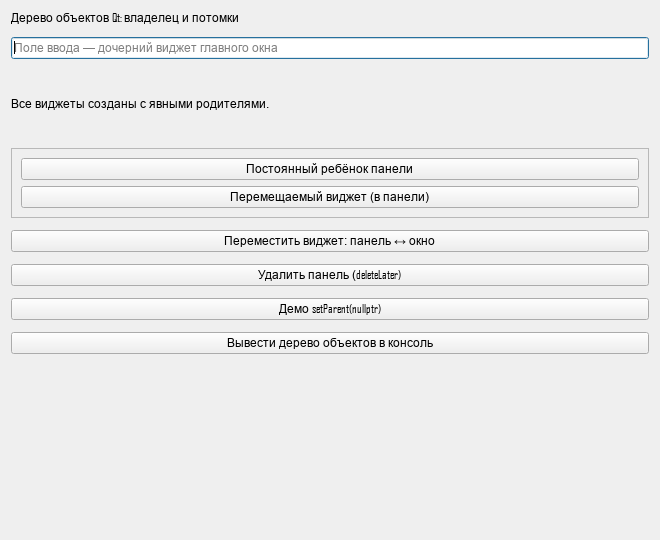
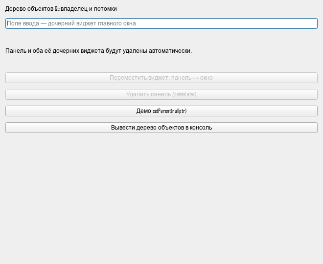
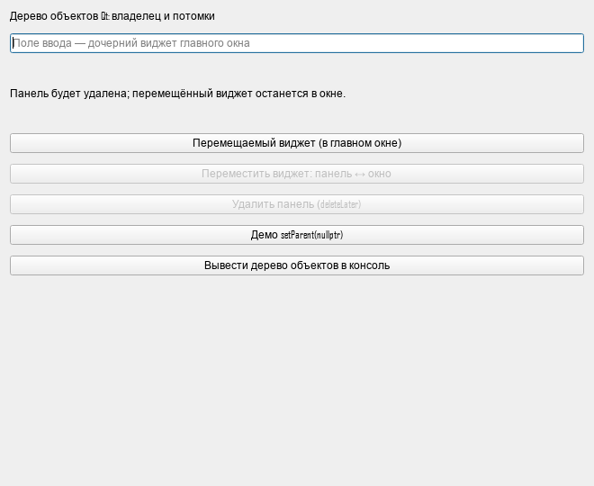

# Лабораторная работа № 2

**Дисциплина:** Основы кроссплатформенного программирования  
**Тема:** Дерево объектов Qt и автоматическое удаление виджетов  
**Выполнил:** Кудаев Максим Сергеевич  
**Группа:** ПИЖ-б-о-24-1  
**Вуз:** Северо-Кавказский федеральный университет, Институт перспективной инженерии  
**Направление:** 09.03.04 «Программная инженерия»  
**Дата:** 21 октября 2026 года  
**Преподаватель:** ФИО не указано в предоставленном отчёте первой работы.

## Цель работы

Изучить механизм дерева объектов Qt, принцип владения объектами через родителя, автоматическое удаление дочерних объектов при уничтожении родителя, а также разобраться в корректном и некорректном использовании `setParent()` в приложениях Qt Widgets.

## Постановка задачи

1. Создать приложение Qt Widgets с не менее чем пятью виджетами и явно заданными родителями.
2. Вывести сообщения `qDebug()` в конструкторах и деструкторах отслеживаемых классов.
3. Продемонстрировать удаление дочерних виджетов при удалении панели-владельца.
4. Перемещать виджет между панелью и главным окном через `setParent()` с обновлением layout.
5. Показать отделение объекта через `setParent(nullptr)` и его отдельное удаление.
6. Применить `QPointer`, разобрать не менее трёх ошибок управления временем жизни.
7. Оформить отчёт в README и письменно ответить на все контрольные вопросы.

В отличие от первой работы (консольный калькулятор, вариант 6), здесь используется `QApplication`, графический интерфейс и цикл событий `app.exec()`. Индивидуальные варианты в задании второй работы отсутствуют. 

## Теоретическое обоснование

`QObject` предоставляет модель родительского владения: объект имеет не более одного родителя и список непосредственных детей. При уничтожении владельца удаляются и его дочерние объекты. Вручную удалённый ребёнок исключается из списка родителя, поэтому корректное раннее удаление само по себе не ведёт к повторному удалению родителем.

Для `QWidget` родитель задаёт также визуальный контейнер. Layout управляет размещением, а время жизни виджетов определяется деревом родителей. `removeWidget()` исключает виджет из размещения, но не уничтожает его и не меняет родителя.

При `setParent()` меняется владелец. Для переноса между контейнерами программа исключает виджет из старого layout, назначает родителя, добавляет виджет в новый layout и вызывает `show()`. При `setParent(nullptr)` виджет становится самостоятельным окном без прежнего владельца; ответственность за его удаление должна быть определена явно.

`delete` уничтожает объект сразу. `deleteLater()` отправляет событие отложенного удаления; объект продолжает существовать до обработки этого события. Поэтому запрещать повторные операции лучше сразу после запроса удаления. В приложении для этого служит `m_deletionPending`. Если главный цикл событий уже завершён, рассчитывать на новый вызов `deleteLater()` нельзя.

`QPointer<T>` наблюдает за объектом и обнуляется при его уничтожении, но не владеет памятью. Он используется для панели, её layout и перемещаемого виджета. Обычные указатели оставлены для элементов, которые живут вместе с главным окном и отдельно не удаляются. Обращаться к ним из деструктора окна или после его уничтожения нельзя.

Метаобъектная система Qt обеспечивает сигналы, слоты и сведения о типах. `Q_OBJECT` и обработка MOC нужны классу `MainWindow` с объявленными слотами. Наследникам виджетов, добавляющим только журналирование, собственный `Q_OBJECT` не нужен. Для обработчиков используются типобезопасные соединения и контекстные объекты.

### Начальное дерево виджетов

```text
MainWindow
├── title: LogLabel
├── input: LogLineEdit
├── status: LogLabel
├── OwnerPanel: LogPanel
│   ├── staticButton: LogButton
│   └── movable: LogButton
├── moveButton: LogButton
├── deleteButton: LogButton
├── detachButton: LogButton
└── treeButton: LogButton
```

На схеме показаны виджеты; у главного окна и панели также есть объекты layout. Кнопка «Вывести дерево объектов в консоль» вызывает `dumpObjectTree()` и показывает фактическое дерево, включая layout.

## Структура проекта

| Файл | Назначение |
| --- | --- |
| `ObjectTreeDemo.pro` | Основная сборка qmake, Qt Widgets, C++17 |
| `main.cpp` | Создание QApplication и запуск цикла событий |
| `mainwindow.h`, `mainwindow.cpp` | Интерфейс и сценарии владения |
| `widgets.h` | LogLabel, LogButton, LogLineEdit, LogPanel |
| `tests/ownership_tests.pro`, `tests/ownership_tests.cpp` | Проверки времени жизни через Qt Test |
| `CMakeLists.txt` | Альтернативная сборка приложения и тестов |
| `.gitignore` | Исключения для SDK, сборки и временных файлов |
| `docs/` | Результаты проверки и снимки интерфейса |
| `Лабораторная работа 2.pdf` | Исходное задание |

## Сборка и запуск

Требуются Qt 5.15 или Qt 6 с модулями Widgets и Test, компилятор с поддержкой C++17. Для Qt 6 рекомендуется использовать совместимый комплект из Qt Creator. Команды выполняются из папки лабораторной в терминале выбранного Qt-комплекта.

### Быстрый запуск в текущей папке

Приложение уже собрано для Windows x64: запустите `Run.cmd`. Он подключает локальный Qt SDK и открывает `build/release/ObjectTreeDemo.exe`. Эти служебные файлы остаются на текущем компьютере и исключены из Git. После клонирования репозитория приложение нужно собрать самостоятельно.

### Qt Creator

Откройте `ObjectTreeDemo.pro`, выберите установленный Desktop kit, соберите и запустите приложение. Вывод `qDebug()` находится в Application Output («Вывод приложения»). Форма `.ui` не требуется: интерфейс создаётся кодом.

### qmake

```sh
mkdir build
cd build
qmake ../ObjectTreeDemo.pro
make
./ObjectTreeDemo
```

В Windows с MinGW вместо `make` используйте `mingw32-make`, с MSVC — `nmake` в Developer Command Prompt. При сборке MSVC в режиме release исполняемый файл находится в `release/ObjectTreeDemo.exe`. Для запуска вне Qt Creator каталог `bin` установленного Qt должен быть в `PATH`; для переноса на другой компьютер используется `windeployqt`.

### CMake

```sh
cmake -S . -B build-cmake -DCMAKE_PREFIX_PATH="/path/to/Qt/kit"
cmake --build build-cmake --config Release
ctest --test-dir build-cmake -C Release --output-on-failure
```

Укажите путь к своему Qt-комплекту. Для сборки только приложения добавьте `-DBUILD_TESTING=OFF`.

### Проверка через qmake

```sh
mkdir build-tests
cd build-tests
qmake ../tests/ownership_tests.pro
make
./ownership_tests -platform offscreen
```

В Windows также замените команду сборки и путь к исполняемому файлу в соответствии с комплектом. `offscreen` позволяет запускать проверки без интерактивного окна. Восемь тестовых сценариев охватывают начальное дерево, каскадное удаление, сохранение перенесённого виджета, обратный перенос, повторные действия, отделение ребёнка, очистку при завершении и удаление перенесённого ребёнка вместе с окном.

## Ход выполнения

1. Настроен Qt Widgets проект, включён C++17 и консольный вывод в Windows.
2. Добавлены производные классы с выводом имён объектов при создании и уничтожении.
3. Созданы главное окно, панель и дочерние элементы с явными родителями.
4. Реализован перенос `movable` из панели в окно и обратно с обновлением layout.
5. Добавлено удаление панели через `deleteLater()` и немедленная блокировка повторных операций.
6. В отдельной демонстрации созданы `TempOwner` и две метки. Одна отвязывается от родителя. После уничтожения владельца queued-обработчик проверяет, что отвязанная метка ещё существует, и отдельно вызывает для неё `deleteLater()`.
7. Добавлена резервная очистка отвязанной метки при уничтожении главного окна до обработки очереди событий. Соединения с контекстом метки автоматически отключаются при её удалении.
8. Подготовлены проверки Qt Test и отчёт с разбором ошибок.

## Листинг кода с комментариями

Полный листинг основных исходников приведён ниже; тесты находятся в `tests/ownership_tests.cpp`.

### ObjectTreeDemo.pro

```qmake
QT += widgets
CONFIG += c++17 console
CONFIG -= app_bundle
TARGET = ObjectTreeDemo
TEMPLATE = app
SOURCES += main.cpp mainwindow.cpp
HEADERS += mainwindow.h widgets.h
msvc:QMAKE_CXXFLAGS += /utf-8
```

### widgets.h

```cpp
#ifndef WIDGETS_H
#define WIDGETS_H

#include <QDebug>
#include <QFrame>
#include <QLabel>
#include <QLineEdit>
#include <QPushButton>

// These wrappers log lifetime without owning any extra resources.
class LogLabel : public QLabel
{
public:
    LogLabel(const QString &name, const QString &text, QWidget *parent)
        : QLabel(text, parent)
    { setObjectName(name); qDebug() << "[CREATE] LogLabel" << objectName(); }
    ~LogLabel() override { qDebug() << "[DESTROY] LogLabel" << objectName(); }
};

class LogButton : public QPushButton
{
public:
    LogButton(const QString &name, const QString &text, QWidget *parent)
        : QPushButton(text, parent)
    { setObjectName(name); qDebug() << "[CREATE] LogButton" << objectName(); }
    ~LogButton() override { qDebug() << "[DESTROY] LogButton" << objectName(); }
};

class LogLineEdit : public QLineEdit
{
public:
    explicit LogLineEdit(QWidget *parent) : QLineEdit(parent)
    { setObjectName("input"); qDebug() << "[CREATE] LogLineEdit" << objectName(); }
    ~LogLineEdit() override { qDebug() << "[DESTROY] LogLineEdit" << objectName(); }
};

class LogPanel : public QFrame
{
public:
    LogPanel(const QString &name, QWidget *parent) : QFrame(parent)
    {
        setObjectName(name);
        setFrameShape(QFrame::StyledPanel);
        qDebug() << "[CREATE] LogPanel" << objectName();
    }
    ~LogPanel() override { qDebug() << "[DESTROY] LogPanel" << objectName(); }
};
#endif
```

### mainwindow.h

```cpp
#ifndef MAINWINDOW_H
#define MAINWINDOW_H

#include <QPointer>
#include <QVBoxLayout>
#include <QWidget>
#include "widgets.h"

class MainWindow : public QWidget
{
    Q_OBJECT
public:
    explicit MainWindow(QWidget *parent = nullptr);
    ~MainWindow() override;

private slots:
    void moveMovableWidget();
    void deletePanel();
    void demoDetaching();

private:
    void setStatus(const QString &text);
    QVBoxLayout *m_rootLayout = nullptr; // Owned by this; never deleted separately.
    QPointer<QVBoxLayout> m_panelLayout;
    QPointer<LogPanel> m_panel;
    QPointer<LogButton> m_movable;
    LogLabel *m_status = nullptr;
    LogButton *m_moveButton = nullptr;
    LogButton *m_deleteButton = nullptr;
    bool m_deletionPending = false;
};
#endif
```

### mainwindow.cpp

```cpp
#include "mainwindow.h"

#include <QTimer>

MainWindow::MainWindow(QWidget *parent) : QWidget(parent)
{
    setObjectName("MainWindow");
    setWindowTitle(QStringLiteral("Лабораторная 2 — Дерево объектов Qt"));
    resize(660, 540);
    qDebug() << "[CREATE] MainWindow";
    m_rootLayout = new QVBoxLayout(this);
    m_rootLayout->setSpacing(12);
    auto *title = new LogLabel("title", QStringLiteral("Дерево объектов Qt: владелец и потомки"), this);
    m_rootLayout->addWidget(title);
    auto *input = new LogLineEdit(this);
    input->setPlaceholderText(QStringLiteral("Поле ввода — дочерний виджет главного окна"));
    m_rootLayout->addWidget(input);
    m_status = new LogLabel("status", QStringLiteral("Все виджеты созданы с явными родителями."), this);
    m_status->setWordWrap(true);
    m_status->setMinimumHeight(65);
    m_rootLayout->addWidget(m_status);

    m_panel = new LogPanel("OwnerPanel", this);
    m_panelLayout = new QVBoxLayout(m_panel.data());
    m_panelLayout->addWidget(new LogButton("staticButton", QStringLiteral("Постоянный ребёнок панели"), m_panel.data()));
    m_movable = new LogButton("movable", QStringLiteral("Перемещаемый виджет (в панели)"), m_panel.data());
    m_panelLayout->addWidget(m_movable.data());
    m_rootLayout->addWidget(m_panel.data());

    m_moveButton = new LogButton("moveButton", QStringLiteral("Переместить виджет: панель ↔ окно"), this);
    connect(m_moveButton, &QPushButton::clicked, this, &MainWindow::moveMovableWidget);
    m_rootLayout->addWidget(m_moveButton);
    m_deleteButton = new LogButton("deleteButton", QStringLiteral("Удалить панель (deleteLater)"), this);
    connect(m_deleteButton, &QPushButton::clicked, this, &MainWindow::deletePanel);
    m_rootLayout->addWidget(m_deleteButton);
    auto *detach = new LogButton("detachButton", QStringLiteral("Демо setParent(nullptr)"), this);
    connect(detach, &QPushButton::clicked, this, &MainWindow::demoDetaching);
    m_rootLayout->addWidget(detach);
    auto *tree = new LogButton("treeButton", QStringLiteral("Вывести дерево объектов в консоль"), this);
    connect(tree, &QPushButton::clicked, this, [this] { dumpObjectTree(); });
    m_rootLayout->addWidget(tree);
    m_rootLayout->addStretch();
}

MainWindow::~MainWindow()
{
    // QObject's destructor will delete the children after this body runs.
    qDebug() << "[DESTROY] MainWindow";
}

void MainWindow::setStatus(const QString &text)
{
    m_status->setText(text);
    qDebug().noquote() << "[STATUS]" << text;
}

void MainWindow::moveMovableWidget()
{
    if (!m_movable || !m_panel || m_deletionPending) {
        setStatus(QStringLiteral("Перемещение невозможно: панель удалена или ожидает удаления."));
        return;
    }
    if (m_movable->parentWidget() == m_panel.data()) {
        m_panelLayout->removeWidget(m_movable.data());
        m_movable->setParent(this);
        m_rootLayout->insertWidget(m_rootLayout->indexOf(m_panel.data()) + 1, m_movable.data());
        m_movable->setText(QStringLiteral("Перемещаемый виджет (в главном окне)"));
        setStatus(QStringLiteral("Новый владелец — главное окно. Удаление панели не удалит этот виджет."));
    } else {
        m_rootLayout->removeWidget(m_movable.data());
        m_movable->setParent(m_panel.data());
        m_panelLayout->addWidget(m_movable.data());
        m_movable->setText(QStringLiteral("Перемещаемый виджет (в панели)"));
        setStatus(QStringLiteral("Владелец снова панель. Виджет будет удалён вместе с ней."));
    }
    // setParent hides a widget; adding it to a layout alone is insufficient.
    m_movable->show();
    qDebug() << "[SET_PARENT]" << m_movable->parentWidget()->objectName();
}

void MainWindow::deletePanel()
{
    if (!m_panel || m_deletionPending) {
        setStatus(QStringLiteral("Панель уже удалена или ожидает удаления."));
        return;
    }
    m_deletionPending = true;
    m_moveButton->setEnabled(false);
    m_deleteButton->setEnabled(false);
    const bool childInside = m_movable && m_movable->parentWidget() == m_panel.data();
    setStatus(childInside ? QStringLiteral("Панель и оба её дочерних виджета будут удалены автоматически.")
                          : QStringLiteral("Панель будет удалена; перемещённый виджет останется в окне."));
    qDebug() << "[DELETE_LATER] OwnerPanel";
    m_panel->deleteLater();
}

void MainWindow::demoDetaching()
{
    auto *owner = new LogPanel("TempOwner", this);
    owner->hide();
    new LogLabel("attachedChild", QStringLiteral("Остаётся у родителя"), owner);
    QPointer<LogLabel> detached = new LogLabel("detachedChild", QStringLiteral("Отвязанный ребёнок"), owner);
    qDebug() << "[DEMO] Children before detach:" << owner->children().size();
    detached->setParent(nullptr);
    qDebug() << "[DEMO] Children after detach:" << owner->children().size();

    // destroyed is emitted before child destruction. A queued callback runs later.
    // The detached object is the callback context so Qt cancels it if it dies first.
    connect(owner, &QObject::destroyed, detached.data(), [detached] {
        qDebug() << "[DEMO] Detached survived owner:" << !detached.isNull();
        if (detached)
            detached->deleteLater();
    }, Qt::QueuedConnection);
    // Also cover application shutdown before the queued callback is processed.
    connect(this, &QObject::destroyed, detached.data(), [detached] { delete detached.data(); });
    owner->deleteLater();
    setStatus(QStringLiteral("Демо: дочерняя метка удаляется с TempOwner; отвязанная переживает его и удаляется отдельно."));
}
```

### main.cpp

```cpp
#include <QApplication>
#include "mainwindow.h"

int main(int argc, char *argv[])
{
    QApplication app(argc, argv);
    MainWindow window;
    window.show();
    return app.exec();
}
```

## Пример работы и проверка

Для независимых сценариев A, B и D перезапустите приложение: удалённая панель в рамках одного запуска не восстанавливается.

| № | Действие | Ожидаемое поведение |
| --- | --- | --- |
| 1 | Запустить приложение | Окно содержит более пяти виджетов; журнал показывает `[CREATE]` |
| 2 | Нажать «Вывести дерево объектов» | В консоли появляется иерархия с `OwnerPanel` и её детьми |
| 3 | A: удалить панель без переноса | Уничтожаются OwnerPanel, staticButton и movable |
| 4 | Повторить удаление | Кнопка недоступна, повторное удаление невозможно |
| 5 | B: после нового запуска перенести movable в окно | В журнале `[SET_PARENT] "MainWindow"`, кнопка видна вне панели |
| 6 | B: удалить панель | staticButton удалён, movable остаётся видимым и живым |
| 7 | C: нажать «Демо setParent(nullptr)» | Число детей TempOwner меняется с 2 на 1; отвязанная метка переживает владельца |
| 8 | D: после нового запуска перенести виджет туда и обратно, удалить панель | movable снова удаляется вместе с панелью |
| 9 | Закрыть главное окно | Удаляются оставшиеся дочерние объекты, включая перенесённый movable |

### Результаты запуска

Проверка выполнена 21 октября 2026 года на Windows 10 x64, Qt 6.8.3, MSVC x64 19.50, C++17. Приложение и тесты успешно собраны через qmake и nmake. Автоматические сценарии выполнены с платформой `offscreen`.

```text
Totals: 10 passed, 0 failed, 0 skipped, 0 blacklisted, 114ms
```

Это восемь содержательных проверок и два служебных этапа `initTestCase`/`cleanupTestCase`. Полный протокол: [docs/test-results.txt](docs/test-results.txt). Профилирование памяти внешним инструментом не выполнялось; тесты проверяют конкретные сценарии владения и уничтожения.

Для снимков через offscreen в Windows дополнительно задано `QT_QPA_FONTDIR=C:/Windows/Fonts`, чтобы использовать системные шрифты. При обычном запуске с Windows-плагином эта настройка не нужна. Предупреждения `This plugin does not support propagateSizeHints()` в протоколе относятся к offscreen-плагину.

**Начальное окно:**



**Сценарий A: панель удалена вместе с детьми:**



**Сценарий B: перемещённый виджет пережил удаление панели:**



Фрагмент фактического протокола сценария C:

```text
[DEMO] Children before detach: 2
[DEMO] Children after detach: 1
[DESTROY] LogPanel "TempOwner"
[DESTROY] LogLabel "attachedChild"
[DEMO] Detached survived owner: true
[DESTROY] LogLabel "detachedChild"
```

## Разбор ошибок и решений

Ниже приведены разобранные опасные примеры. Они не включены в исполняемую программу: намеренный запуск неопределённого поведения не нужен для объяснения причины ошибки.

### 1. Удаление родителя раньше стекового ребёнка

```cpp
QWidget *parent = new QWidget;
QLabel child("Danger", parent);
delete parent; // Неверно: родитель пытается delete-удалить стековый child.
```

Это неопределённое поведение: стековая память не была выделена через `new`. Кроме того, при выходе из области видимости деструктор ребёнка должен был бы вызываться ещё раз. Решение: создать дочерний объект через `new` и передать родителя либо использовать безопасный порядок стековых объектов:

```cpp
QWidget parent;
QLabel child("Safe", &parent); // Создан позже; уничтожится раньше parent.
```

Само сочетание стекового ребёнка и кучного родителя не запрещено языком: важно, чтобы ребёнок успел разрушиться и отсоединиться до родителя. В работе используется более простой подход — дочерние виджеты создаются в куче с явным родителем.

### 2. Утечка после setParent(nullptr)

```cpp
QLabel *child = new QLabel("Detached", parent);
child->setParent(nullptr);
// Ошибка: потерять child, не назначив нового владельца и не удалив его.
```

Прежний родитель больше не удалит ребёнка. В демонстрации queued-обработчик отдельно вызывает `deleteLater()` для отвязанной метки; при раннем завершении её удаляет обработчик уничтожения главного окна.

### 3. Висячий указатель после удаления панели

```cpp
QPointer<QPushButton> child = new QPushButton("Safe", panel);
panel->deleteLater();
// Позднее, после обработки DeferredDelete:
if (child)
    child->setText("Still alive");
```

Обычный указатель не обнуляется и после фактического удаления ребёнка становится висячим. `QPointer` позволяет проверить его состояние. Сразу после `deleteLater()` ребёнок ещё может существовать: этот вызов сам по себе не означает немедленного уничтожения. В тестах проверяются оба момента.

### 4. Перенос без layout и show()

Один вызов `setParent(newParent)` меняет владельца, но не обеспечивает нужное размещение; виджет также скрывается. Решение: `removeWidget()`, `setParent()`, `addWidget()` или `insertWidget()`, `show()`. Тест проверяет нового родителя, наличие в layout и отсутствие признака скрытого виджета.

### 5. Повторное действие до отложенного удаления

До события `DeferredDelete` панель ещё существует и `QPointer` не пуст. Поэтому одной проверки указателя мало для блокировки повторного действия. Решение: флаг `m_deletionPending` и отключение кнопок сразу при запросе удаления. Прямые повторные вызовы слотов также безопасно отклоняются.

### Проблемы, выявленные при выполнении

1. **Кириллица в пути сборки MSVC/qmake.** Установщик SDK попытался прочитать вывод qmake как UTF-8, хотя тот содержал текст в системной кодировке. Сам SDK распаковался. Для локального Qt задан ASCII-путь через короткое имя каталога в `qt.conf`; сгенерированные Makefile перекодированы в Windows-1251 для nmake. Исходники сохранены в UTF-8, для компилятора включён `/utf-8`. В другой среде проще использовать путь к комплекту и каталогу сборки без кириллицы.
2. **Поиск наследников без собственного Q_OBJECT в тестах.** `findChild<LogPanel*>()` вызвал статическую ошибку компиляции Qt. Тесты ищут элементы по `objectName()` через базовые Qt-типы с метаобъектом (`QFrame`, `QPushButton`, `QLabel`); классы журналирования не нуждаются в дополнительной метаинформации.
3. **Отсутствие шрифтов у offscreen-плагина.** Первые снимки содержали квадраты вместо букв. Для тестового запуска указан каталог системных шрифтов `QT_QPA_FONTDIR`; повторно полученные снимки проверены визуально, русский текст читается.

## Вывод

Разработано приложение Qt Widgets, демонстрирующее родительское владение, смену владельца и отдельное время жизни отвязанного виджета. Основная сложность — различать запрос `deleteLater()` и фактическое уничтожение, а также обновлять layout после переноса. Для объектов с переменным временем жизни применён `QPointer`, повторные действия блокируются до удаления. Принципы работы дерева объектов разобраны; полная проверка отсутствия утечек требует отдельного профилирования памяти.

## Git-репозиторий и сдача

Проект ведётся в отдельном локальном Git-репозитории в папке `2`. История содержит осмысленные этапы настройки, реализации виджетов, интерфейса, тестов и отчёта. Бинарные файлы и SDK не включаются в репозиторий.

**Публичный репозиторий:** [SETAVR/ObjectTreeDemo](https://github.com/SETAVR/ObjectTreeDemo). Для СЭО используется эта ссылка.

Отчёт размещён в README в соответствии с актуальными требованиями преподавателя.

## Источники

- [Методические указания к лабораторной работе № 2](<Лабораторная работа 2.pdf>).
- [Qt: Object Trees & Ownership](https://doc.qt.io/qt-6/objecttrees.html).
- [Qt: QObject и deleteLater](https://doc.qt.io/qt-6/qobject.html#deleteLater).
- [Qt: QWidget::setParent](https://doc.qt.io/qt-6/qwidget.html#setParent).
- [Qt: QPointer](https://doc.qt.io/qt-6/qpointer.html).

## Контрольные вопросы и ответы

### 1. Что такое дерево объектов QObject?

Иерархия объектов, связанных отношением родитель–ребёнок. Объект имеет одного родителя или не имеет его; дочерних объектов может быть несколько.

### 2. Кто является владельцем дочернего объекта?

Его родитель, заданный при создании либо методом `setParent()`. Владение означает ответственность за удаление ребёнка при уничтожении родителя.

### 3. Что произойдёт при удалении родителя?

Будут автоматически удалены его дочерние объекты и их потомки. Отсоединённые или перенесённые к другому родителю объекты этим удалением не затрагиваются.

### 4. Чем QWidget-дерево отличается от простого QObject-дерева?

Помимо владения, родитель виджета определяет визуальное вложение, систему координат и ограничения отображения ребёнка. Обычный QObject может вообще не иметь визуального представления.

### 5. Зачем передавать parent в конструктор виджета?

Чтобы сразу определить владельца и визуальный контейнер. Это упрощает управление памятью и позволяет автоматически удалить виджет вместе с родителем.

### 6. Что делает setParent()?

Меняет родителя, исключая объект из списка детей прежнего владельца и добавляя новому. Для QWidget также меняется визуальный контейнер, а виджет скрывается и требует корректного размещения и показа.

### 7. Что произойдёт при вызове setParent(nullptr)?

Объект потеряет родителя. QWidget станет самостоятельным окном; прежний владелец его больше не удалит. Нужно назначить нового владельца или обеспечить отдельное удаление.

### 8. Можно ли вручную удалять объект, у которого есть родитель?

Да, если это допустимо в текущем контексте выполнения. Он удалит себя из списка детей, и родитель не удалит его повторно. Остальные обычные указатели на него станут недействительными.

### 9. Почему опасно удалять объект через delete внутри обработчика его собственного сигнала?

Объект может всё ещё участвовать в обработке события или выполнении кода, который ожидает его существования. Возврат к такому коду опасен. Обычно используют `deleteLater()`, чтобы отложить уничтожение.

### 10. Чем deleteLater() отличается от delete?

`delete` уничтожает сразу; `deleteLater()` планирует отложенное удаление через механизм событий Qt. До фактического удаления объект ещё существует. Вызов после остановки основного цикла не гарантирует очистку.

### 11. Что такое висячий указатель?

Указатель на объект, который уже уничтожен. Значение адреса может сохраняться, но разыменовывание приводит к неопределённому поведению.

### 12. Как QPointer помогает избежать работы с удалённым объектом?

Он автоматически становится нулевым после уничтожения отслеживаемого QObject. Перед обращением проверяют `if (pointer)` или `isNull()`. Он не продлевает время жизни объекта.

### 13. Почему стековый объект нельзя делать ребёнком кучного родителя?

Опасен случай, когда родитель уничтожается раньше ребёнка: он попытается вызвать `delete` для стекового объекта. Формулировка не является абсолютным запретом: если ребёнок раньше завершает свою область видимости, он отсоединяется безопасно. Для простоты обычно используют дочерний объект в куче с родителем либо правильный обратный порядок разрушения стековых объектов.

### 14. Как правильно перемещать виджет из одного layout в другой?

Удалить из старого layout через `removeWidget()`, сменить родителя через `setParent()`, добавить в новый layout и вызвать `show()`. При работе с потенциально удаляемыми контейнерами сначала проверить указатели и состояние.

### 15. Что произойдёт, если удалить родителя, а затем обратиться к указателю на ребёнка?

Если ребёнок принадлежал родителю на момент удаления, он тоже уничтожен. Доступ через обычный указатель — неопределённое поведение. `QPointer` обнулится и позволит пропустить обращение.

### 16. Как отследить момент уничтожения объекта через деструктор?

Создать наследника, переопределить виртуальный деструктор и вывести через `qDebug()` тип и `objectName()`. Для внешнего наблюдения можно подключиться к сигналу `destroyed()`.

### 17. Почему порядок вызова деструкторов родителя и детей может быть неочевидным?

Сначала выполняется тело деструктора производного класса родителя, затем разрушаются его члены и базовые классы. Удаление детей происходит в базовом механизме QObject, поэтому сообщение деструктора MainWindow может предшествовать сообщениям дочерних виджетов.

### 18. Что возвращает children() у QObject?

Список непосредственных дочерних QObject (`const QObjectList &`). Он может включать виджеты, layout и другие служебные объекты, но не включает всех потомков рекурсивно.

### 19. Чем findChildren<QWidget*>() отличается от children()?

`findChildren<QWidget*>()` отбирает объекты нужного типа и по умолчанию ищет рекурсивно; доступен поиск только непосредственных детей. `children()` возвращает непосредственных детей всех QObject-типов без такого фильтра.

### 20. Можно ли иметь у объекта несколько родителей?

Нет. У QObject может быть только один текущий родитель. Назначение нового родителя прекращает прежнее отношение владения.

### 21. Как связано дерево объектов и цикл событий Qt?

Немедленное каскадное удаление при уничтожении родителя не требует цикла событий. Для обычной обработки `deleteLater()`, queued-сигналов, таймеров и пользовательских событий нужен работающий механизм обработки событий в соответствующем потоке.

### 22. Почему для GUI-приложения нужен QApplication и app.exec()?

`QApplication` подготавливает инфраструктуру Qt Widgets. `app.exec()` запускает обработку событий, благодаря которой работают окно, ввод пользователя, перерисовка и отложенные действия.

### 23. Что произойдёт, если попытаться сделать родителем объект из другого потока?

Qt отклонит установку такого родителя и выведет предупреждение о разных потоках. Связанные родительством QObject должны иметь одну потоковую принадлежность; QWidget создаются и используются в GUI-потоке, переносить их в рабочий поток нельзя.

### 24. Как проверить отсутствие утечек памяти?

Сопоставить создание и уничтожение объектов, проверить QPointer и сигнал destroyed, выполнить повторные сценарии и раннее завершение. Для полной проверки использовать профилировщик памяти или LeakSanitizer в поддерживаемой среде, например Valgrind на Linux. Одни сообщения деструкторов не доказывают отсутствие всех утечек.

### 25. Почему в данной работе используется QPointer, а не обычные указатели?

Панель, её layout и перемещаемый виджет могут исчезнуть раньше главного окна. `QPointer` обнуляется при их удалении и позволяет безопасно отказаться от операции. Для неизменяемых по времени жизни элементов, принадлежащих окну, обычные указатели достаточны, пока живо само окно.
